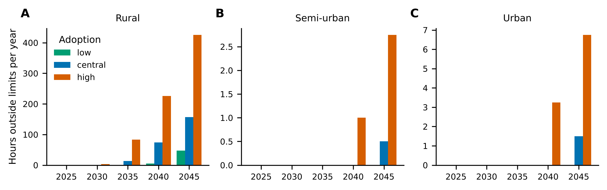
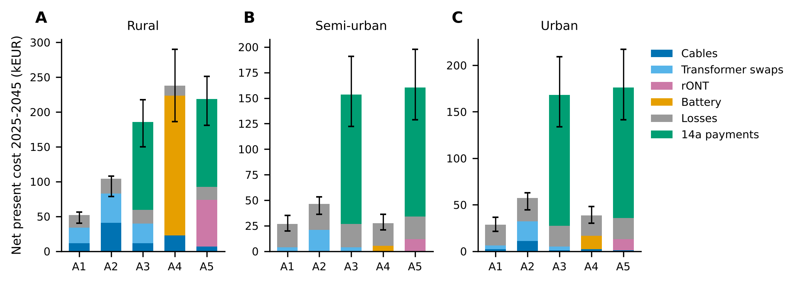
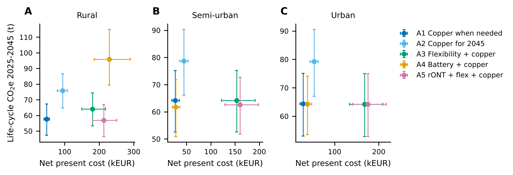
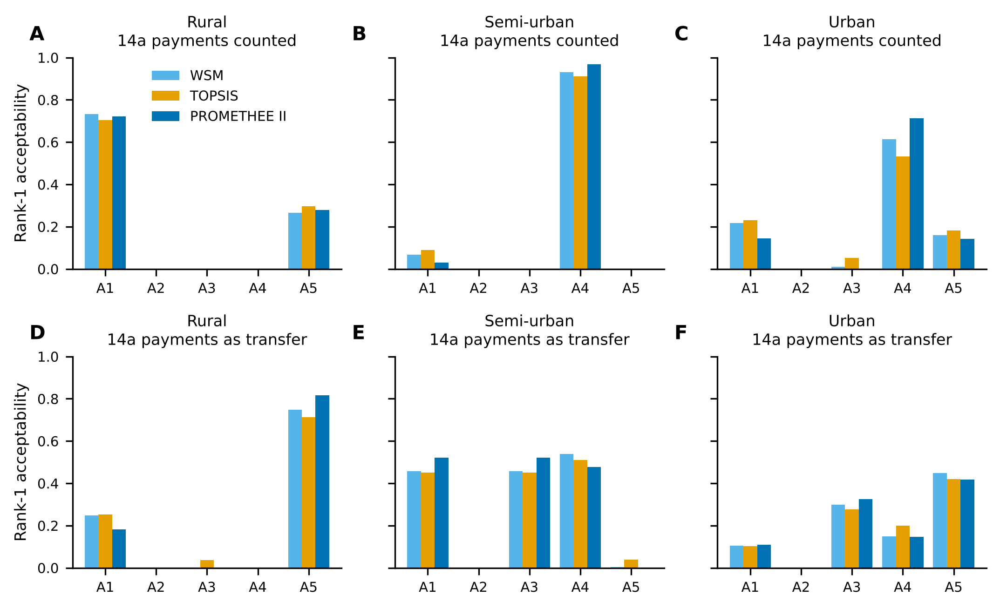
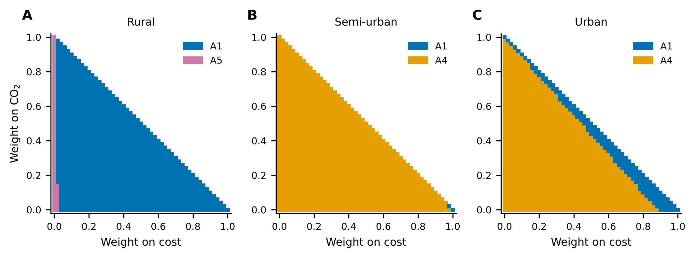

# Copper or flexibility? Long-term planning of low-voltage feeders

How should a distribution system operator prepare a low-voltage feeder for heat pumps, electric cars and
rooftop PV between 2025 and 2045: lay more cable and swap the transformer, or use flexibility
(paragraph 14a EnWG control of heat pumps and chargers, a substation battery, a tap-changing
transformer)? And does the answer change once environmental criteria are added to cost?

This repository plans three real-type German feeders (SimBench) along six pathways under three adoption
scenarios, with a full-year quarter-hourly AC power flow at every planning step. It then compares the
pathways on cost, life-cycle CO2, metal use, trenching, shifted energy and robustness, with three
multi-criteria methods and a stochastic multicriteria acceptability analysis (SMAA-2) over both the
weights and the uncertain prices and emission factors.

## Method in one picture

```
SimBench feeder (2016 profiles, 15 min)          params.yaml (every number with source and range)
        |                                                      |
adoption S-curves 2025-2045 (low / central / high)             |
        |                                                      |
step1_plan.py   for each feeder x scenario x pathway:          |
                at 2025, 2030, ..., 2045 make the feeder        |
                compliant for the load of year + 5,             |
                then operate the actual year (35,136 steps)     |
        |                                                      |
results/ledgers.json  (assets built, MWh lost / shifted)       |
        |                                                      |
step2_criteria.py  -----------------------------------------> prices, LCA factors, escalation
step3_mcda.py      WSM, TOPSIS, PROMETHEE II, SMAA-2 (10,000 samples)
step4_figures.py
```

The ledgers hold physical quantities only, so the 10,000 uncertainty samples reuse the same power flows.

## Feeders and scenarios

| Feeder | SimBench code | Households | Transformer | Cable | Hours outside limits in 2045 without action (low / central / high) |
|---|---|---|---|---|---|
| Rural | 1-LV-rural2 | 92 | 250 kVA | 1.47 km NAYY 4x150 | 47 / 157 / 426 |
| Semi-urban | 1-LV-semiurb5 | 92 | 630 kVA | 1.79 km NAYY 4x240 | 0 / 0.5 / 2.8 |
| Urban | 1-LV-urban6 | 102 | 630 kVA | 1.08 km NAYY 4x240 | 0 / 1.5 / 6.8 |

Heat pumps, home chargers and PV are added to households with real SimBench device profiles (taken from
the scenario-2 versions of the same feeders). Shares of households in 2030 / 2045:

| Scenario | Heat pumps | EV chargers | PV |
|---|---|---|---|
| low | 0.10 / 0.50 | 0.15 / 0.60 | 0.20 / 0.35 |
| central | 0.20 / 0.75 | 0.30 / 0.85 | 0.25 / 0.50 |
| high | 0.30 / 0.95 | 0.40 / 0.95 | 0.35 / 0.70 |

These are scenario assumptions, not forecasts. Adoption is nested: a household that adopts in the low
scenario also adopts in the central and high ones, so differences between scenarios are not sampling noise.

Limits (Verteilnetzstudie Baden-Wuerttemberg 2017): voltage 0.915 to 1.05 pu without a tap-changing
transformer (8.5 % drop and 5 % rise for LV network and transformer together), 0.9125 to 1.0875 pu with
one; lines and transformer at most 100 % loading.

## Pathways

| | Pathway | Means |
|---|---|---|
| A0 | Do nothing | reference only, violates the limits |
| A1 | Copper, when needed | parallel cables and the next transformer size, at each planning year |
| A2 | Copper, built for 2045 at once | reinforce in 2025 for the 2045 central load, top up later if needed |
| A3 | Flexibility + copper | paragraph 14a: in violated steps each heat pump and charger is limited to 4.2 kW, the energy is delivered later; copper for the rest |
| A4 | Substation battery + copper | battery sized for the transformer peak (power and daily energy, +20 %), copper for the rest |
| A5 | Tap-changing transformer + flexibility + copper | rONT installed at the first violation, then as A3 |

Copper is placed by a greedy rule: the transformer if it is the most loaded element, otherwise a
parallel cable on the most loaded line, or for voltage problems on the line with the largest drop on
the path to the worst bus. Each planning year is checked over the whole year.

## Criteria (all minimised)

| Criterion | Definition |
|---|---|
| Cost | Net present cost 2025-2045, kEUR of 2025, 5 % real discount rate. Investments as annuities over their life, counted inside the horizon; losses at 100 EUR/MWh; 14a payments of 150 EUR per device and year |
| CO2 | Embodied emissions (EN 15804 A1-A5 + C, spread over the asset life) plus losses times a grid factor falling linearly from 0.363 kg/kWh (2024) to zero in 2045 |
| Metals | Aluminium and copper in new cables, transformers and battery cells (t) |
| Trench | Length of new cable trench (km), a proxy for disruption in the street |
| Shifted energy | Energy delayed by 14a control (MWh over 2025-2045) |
| Regret | Largest cost regret over the three adoption scenarios (kEUR) |

The 14a payments are shown in two views. In the operator view they are a cost of the flexibility
pathways. In the system view they are a transfer between customers and operator and count as zero;
since 2024 new heat pumps and chargers in Germany fall under paragraph 14a anyway, so this view is the
closer one to current regulation.

## Data and sources

Cost data from 2012 and 2016 are escalated to 2025 prices, and the spread between price indices is part of the
uncertainty analysis.

| Item | Value (range) | Source |
|---|---|---|
| LV cable incl. civil works | 80 / 100 / 120 kEUR/km (rural / semi-urban / urban), 2016 prices | Verteilnetzstudie Baden-Wuerttemberg (2017), Table 7.1 |
| Transformer swap; rONT | 15 kEUR; 45 kEUR, 2016 prices | same |
| Cross-check | 60 / 100 kEUR/km, 10 kEUR swap, 2010 prices | dena-Verteilnetzstudie (2012), Table 6.1; gives the 0.8 low end of the source factor |
| Escalation 2016 to 2025 | x1.88 (1.28 to 2.06) | civil-engineering price index for local underground works (Ortskanaele), Amt fuer Statistik Berlin-Brandenburg and Destatis; low end: consumer price index |
| Battery | 250 EUR/kWh + 287.5 EUR/kW (+-30 %), life 15 y (10 to 22.5) | PyPSA technology-data 2025 (Danish Energy Agency catalogue) |
| 14a payment; floor | 150 EUR/device/year (110 to 190); 4.2 kW | Bundesnetzagentur decision on paragraph 14a EnWG (Nov 2023) |
| Loss price; discount rate; asset life | 100 EUR/MWh (60 to 150); 5 % (3 to 7 %); 40 y (35 to 45) | assumptions, sampled |
| Cable LCA, NAYY 4x150 | 27 t CO2e/km (13.7 to 40.4) | Nexans PEP NXNS-00039-V03.02-FR (2024); Hellenic Cables EPD-IES-0016993 (2024) |
| Transformer LCA | 5.5 kg CO2e/kg (3.7 to 8.5) + 500 kg per unit (250 to 950); 2,182 kg at 630 kVA | Cotradis EPDs (EPD Italy 0363, EPDITALY1320), IMEFY EPD |
| Battery LCA | 83.5 kg CO2e/kWh (61 to 106) | IVL (2019); the CATL cell EPD (EPDITALY0392) gives 54 kg for A1-A3 of the cell |
| Battery metals | Cu 0.42 kg/kWh; Al 0.54 kg/kWh (0.18 to 0.90), cells only | IEA HEV TCP Task 40 (2024), Table 2; CATL EPD EPDITALY0392 |
| Grid emission factor | 0.363 kg/kWh in 2024, zero in 2045 (2040 to 2050) | Umweltbundesamt; Climate Protection Act target |
| Feeders and profiles | SimBench 1.6.3 | simbench.de |

Every value, with its full citation, is in [params.yaml](params.yaml). `step0_data_check.py` checks
that each entry has a source and a consistent range.

## Results



**Only the weak rural feeder has a real problem.** With its 250 kVA transformer it is outside the
limits for 157 hours in 2045 in the central scenario (426 in the high one). The two 630 kVA feeders reach
at most 7 hours a year, and only after 2040.



*Central scenario, operator view, central prices; bars show the 5 to 95 % range over the price and
emission uncertainty.*

**Copper when needed (A1) is the cheapest pathway on all three feeders**: 52, 27 and 29 kEUR net present
cost. Building for 2045 at once (A2) costs about twice as much, because the money is spent 15 years
earlier and the larger transformer has higher no-load losses from day one; it never ranks first.

**Paragraph 14a control with a 4.2 kW floor removes little copper.** On the rural feeder A3 still needs
both transformer swaps and saves 68 m of cable; it shifts only 0.56 MWh over 21 years. Most SimBench
heat pumps and home chargers peak at or below 4.2 kW (median 4.0 and 3.7 kW), so the limit hardly
touches the winter and evening peaks. Counted as an operator cost, the payments (127 kEUR on the rural
feeder) make A3 and A5 the most expensive pathways.

**A battery is not a substitute for a weak feeder.** The rural feeder needs 1.08 MWh / 581 kW at the
substation (238 kEUR, highest CO2 of all). On the semi-urban feeder, a 35 kWh battery defers the only
transformer swap at the same cost as A1 (27.4 against 26.8 kEUR).



**Life-cycle CO2 is dominated by losses, not by materials.** For the rural A1, losses give 48 of 57 t
CO2e; cables and transformers 9 t. Apart from A2 and the rural battery, the pathways differ by less than
the uncertainty of the emission factors.



*Share of 10,000 samples (random weights and uncertain parameters) in which each pathway ranks first.
Ties share rank 1 (semi-urban A1 and A3 are identical in the system view).*

**The ranking depends on how the 14a payments are treated, and less on the method.** WSM, TOPSIS and
PROMETHEE II name the same leading pathway in five of the six panels (acceptabilities up to 18
percentage points apart); in the sixth, semi-urban in the system view, A1/A3 and A4 are within 8 points. On the rural feeder A1 wins 70 to 73 % of the samples
in the operator view; in the system view the tap-changing transformer pathway A5 (least cable, least
metal, CO2 equal to A1) wins 71 to 82 %, at 92 against 52 kEUR.

**The battery wins on the 630 kVA feeders only because of the metals criterion.** With metals in the
analysis A4 ranks first in 91 to 97 % (semi-urban) and 53 to 71 % (urban) of the samples. Without it,
A1 and A4 share the semi-urban feeder about evenly and A1 wins the urban feeder in 66 to 77 % (in
`results/smaa.csv`, column `criteria`). The battery's metal use counts cells only, so it is a lower
bound, while the transformer swap counts a whole new unit: this result should not be read as a case for
batteries.



*PROMETHEE II winner at central parameters for weights on cost and CO2; the remaining weight is spread
equally over the other four criteria.*

## Limitations

- One weather and behaviour year (2016) for all planning years; no climate change, no new tariffs.
- SimBench EV profiles have low yearly energy (0.8 MWh median), so EV charging peaks may be understated.
- The 4.2 kW floor is applied to every heat pump and charger; under the rule, heat pumps and air conditioners above 11 kW
  may keep 40 % of their rating, so the flexibility modelled here is, if anything, stronger than allowed.
- Greedy copper placement, no cable replacement by larger sections, no new feeders or substations.
- Swapped transformers are not reused elsewhere; operation and maintenance costs are left out for all
  assets; the old transformer's end of life is not counted.
- The battery operates for the network only (greedy peak shaving), with no market revenue.
- Trenching emissions are not in the cable EPDs (A5 covers installation of the cable only).
- Prices outside Germany and after 2025 may differ; ranges are sampled but not every structural choice is.

## Reproduce

```bash
pip install -r requirements.txt
python step0_data_check.py           # sources and ranges, feeder summary
python step1_plan.py --workers 2     # about 30 min on 2 cores, resumable
python step2_criteria.py
python step3_mcda.py --n 10000       # a few seconds
python step4_figures.py
pytest                               # 11 tests, about 30 s
```

Tests: the vectorised power flow against pandapower, 14a energy shifting, reinforcement clears all
violations, the cost and LCA bookkeeping by hand, the three MCDA methods against pymcdm, a worked
PROMETHEE II example, and SMAA reproducibility.

## Layout

```
lvplan/powerflow.py   vectorised Z-bus power flow over all time steps (pandapower matrices)
lvplan/scenarios.py   feeders, device library, adoption S-curves
lvplan/grid.py        one year of operation: limits, 14a control, battery, tap changer
lvplan/plan.py        pathways and the planning loop
lvplan/criteria.py    costs, life-cycle CO2, metals, trenching from a ledger
lvplan/mcda.py        WSM, TOPSIS, PROMETHEE II and SMAA-2, vectorised over samples
params.yaml           every input with source and range
results/              ledgers, criteria, SMAA tables
figures/              figures 1 to 5
```

## License

MIT
